# 星海拓殖 · 笃实书院64班

一个可直接在手机 / 电脑浏览器运行的 **3D 星球基地经营 H5 原型**。

> 探索地外星球 · 建立基地 · 发展工业 · 研发跨星系飞行器

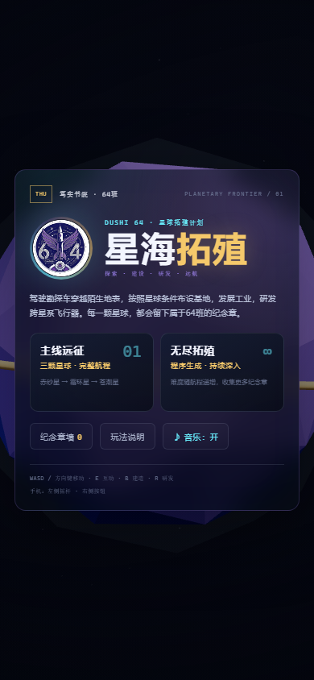

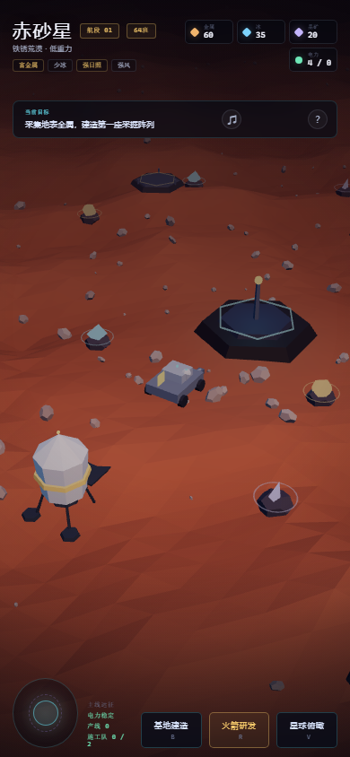

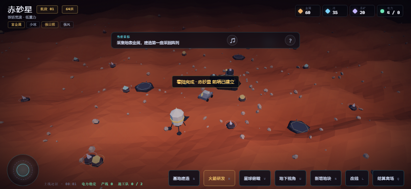

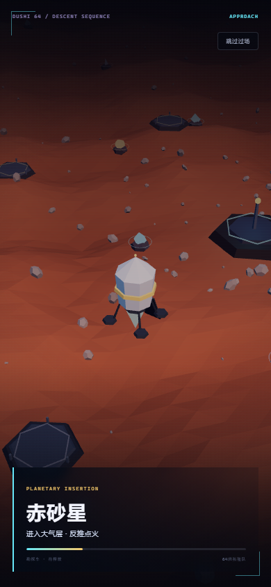

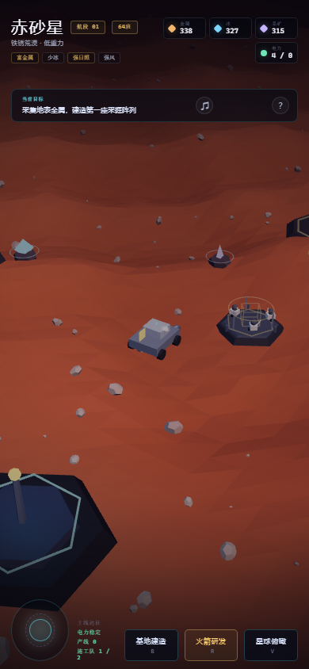

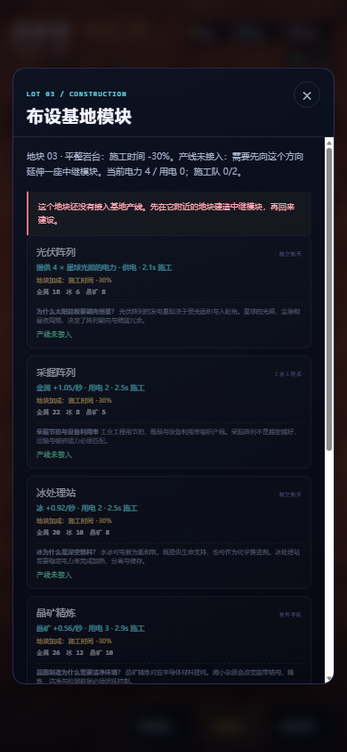

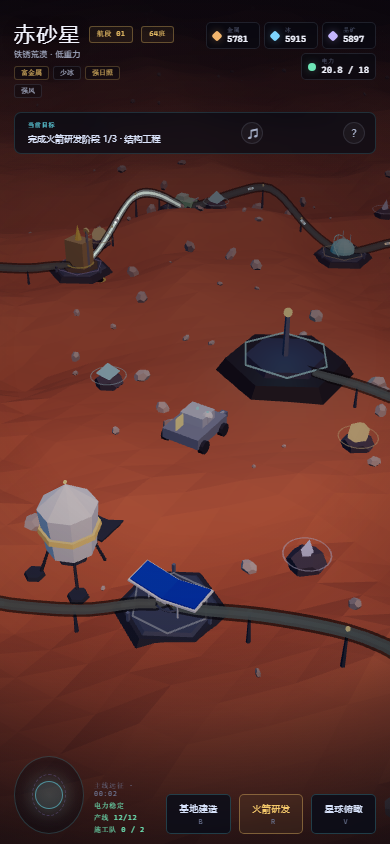

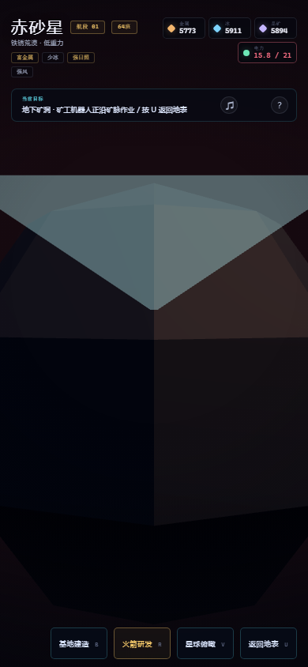

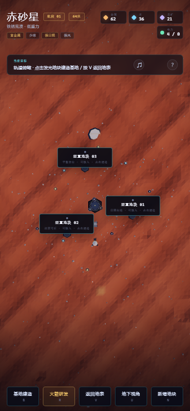

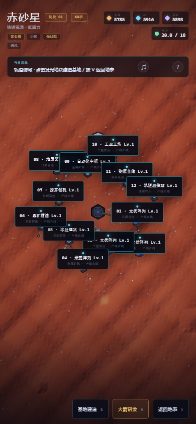

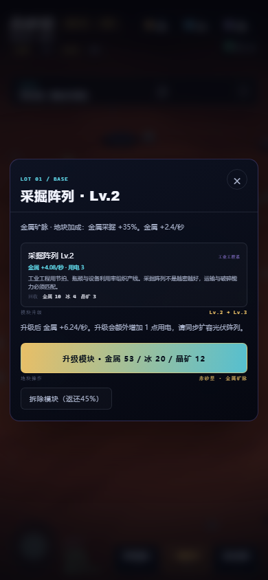

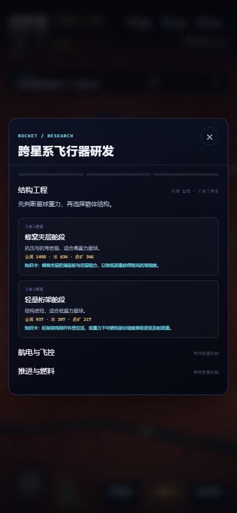

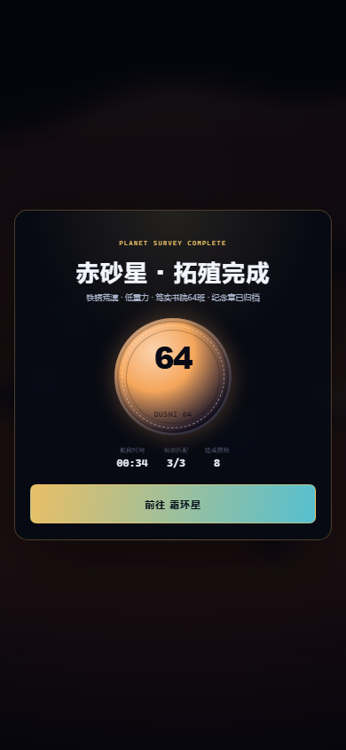

## 玩什么

### 两种模式

- **主线远征**：赤砂星 → 霜环星 → 苍潮星，三颗手工设计星球，每颗约 10–15 分钟。
- **无尽拓殖**：程序生成星球并逐步提高研发成本，持续收集纪念章。

### 核心循环

1. **降落**：每抵达一颗新星球，先播放着陆过场——飞行器从大气层外反推下降、展开支腿、打开舱门，勘探车驶出；可按「跳过过场」。
2. **探索**：驾驶 3D 勘探车在无限程序化地表上移动，靠近金属 / 冰 / 晶矿节点按 `E` 采集（采集有约 1 秒的作业动画）。越往外走，地形与资源节点会持续生成。
3. **建设**：按 `V` 或点「星球俯瞰」进入轨道俯视视角，点击发光地块直接建造；也可以驾驶勘探车靠近地块按 `E`。默认保留 3 个地块，可驾驶勘探车到任意位置按 `N` 低成本新增地块（最多 20 个），注意电力供需。
4. **施工**：确认建造后，资源立即扣除，但模块需要 **3–5 秒施工时间**。四台小机器人会围绕地块搬运、焊接，现场有脚手架、全息蓝图和施工进度；施工完成后模块才接入电网并开始产出。
5. **工业**：采掘阵列、冰处理站、晶矿精炼提供持续产出；自动化中枢与工业工坊提供全局加成。
6. **研发**：建造轨道测控站后，依次完成结构工程、航电与飞控、推进与燃料三个阶段。
7. **远航**：选择与星球条件匹配的火箭方案，点火升空，获得该星球的64班纪念章。

### 三系知识怎么用

| 学科 | 在游戏中的位置 |
| --- | --- |
| 航空航天 | 光伏供电、冰处理、轨道测控、推进器与跨星系航行 |
| 软件学院 | 晶矿精炼、自动化中枢、飞控冗余与反馈控制 |
| 工业工程系 | 采掘节拍、模块化建造、工业工坊与产线平衡 |

每个建造模块和火箭方案都附有一张知识卡。火箭阶段会给出两个方案，**根据星球重力、辐射、冰/光照条件选择更匹配的方案**，可降低研发成本；选错仍可继续，但会超支。

## 策略性

- **产线是硬约束**：基地核心最多下挂 **3 条**产线、普通模块最多下挂 **2 条**；接入范围为核心 **24** / 模块 **22**。外围地块必须先建中继，且线路容量有限，不能把太多下游都挂在一个节点上。
- **产线可视化**：每个在线模块都会从最近的已连接节点拉起一条发光管道，沿地形架设 **中继塔**，管道上持续流动胶囊状货物流光，终点模块带集线环；不同模块的管道颜色不同。
- **拆除中继会断网**：拆掉一条产线中间的模块，下游模块会显示「产线中断」，停止产出、供电和测控；需要重建中继或另找一条连接路径。
- **地块特性随机生成**：每个地块会随机分到日照台地、金属矿脉、冰层穹丘、晶簇裂隙、平整岩台、科研高地等不同特性。匹配模块可获得 **+35%** 产出/供电；平整岩台施工快 30%；科研高地让测控站少耗 1 电并提高研发折扣。
- **支持模块有覆盖半径**：自动化中枢只为 **半径 22** 内的产线提供 +25%，工业工坊只为 **半径 20** 内的产线提供 +15%。把支持模块放在采掘模块之间，还是沿着高加成地块铺开，是核心取舍。
- **施工队限制为 2 支**：同时最多施工两个工地。先建产线、先建支持模块还是先抢高加成地块，需要排优先级。
- **电力与地块耦合**：光伏阵列在日照台地上多供电，但会占用一个宝贵地块；高耗电模块会拉低全基地产线效率。
- **知识方案影响成本**：火箭结构与星球重力、航电与辐射、推进与冰/日照条件匹配时，研发成本最多降低 20%；选错会超支 28%。

建造面板会直接标出当前地块特性、模块是否匹配、产线是否可接入、施工时间、电力变化和支持模块的覆盖数量；轨道俯瞰中可见完整的产线网络。

## 节奏、升级与十分钟目标

- **地表采集被压低**：近基地资源点每次只给 5–9 单位，远方区块节点 4–8 单位，冷却 45 秒。地表采集只用于补缺口，主要资源来自基地产线。
- **建筑产能提高**：采掘阵列 2.4 金属/秒、冰处理站 1.9 冰/秒、晶矿精炼 1.15 晶矿/秒。
- **模块可升级到 Lv.3**：点击已建模块，在面板中升级。Lv.2 / Lv.3 分别把产出提高到 1.7 倍 / 2.6 倍；每升一级额外消耗 1 点电力。光伏阵列升级会提高供电；自动化中枢、工业工坊和测控站的等级也会强化各自效果。
- **火箭更贵**：三段研发的基础成本大幅提高，最终总装与燃料还要额外消耗 **160 金属 / 100 冰 / 80 晶矿**；方案匹配与测控站折扣依然有效。
- **目标时长约 10 分钟**：在正常建设、适度升级、完成三阶段研发并发射的情况下，单颗星球约 10 分钟。顶部状态栏的 `T+mm:ss` 会记录本次探索时间。
- 电力仍然是升级的硬约束：全模块升到 Lv.3 后耗电显著增加，需要提前规划光伏阵列的等级和日照地块。

## 建筑、动画与地底

- **更多槽位与建筑**：默认保留 **3 个地块**，玩家可驾驶勘探车在任意位置按 `N` 低成本新增地块（每种资源各 3）；主线模式上限 20 个，**无尽模式不设上限**。并新增三类建筑——「深井钻机」向下打穿基岩采集晶矿与金属、「地表采集站」派出无人车露天采集金属与冰、「物流仓储」为全基地产线提供 +12% 加成并加快卸货。
- **每栋建筑有独特动画**：光伏阵列电池脉动、采掘阵列钻头升降、冰处理站储罐脉动、晶矿精炼晶体生长、深井钻机钻头与滑轮、地表采集站机械臂与车轮、自动化中枢穹顶脉动、工业工坊料仓脉动、测控站信标闪烁、物流仓储升降平台。
- **收集器派出机器人**：金属/冰/晶矿/深井/地表采集等收集类建筑会持续派出不同的小机器人，缓慢地沿地表往返资源点（或下井）采集，采集后只回到自己的建筑，不再直接向基地运输。
- **机器人调度**：收集机器人之间会做简单的碰撞避让，速度较慢，运输交由连接线完成。
- **地底层**：深井钻机旁会生成一座地下竖井。按 `U` 或点「地下视角」切换到矿洞样式的隧道网格，矿道两侧设有照明灯、交叉处为带晶簇的矿室；采矿机器人在矿洞内开采，并往返地面竖井运输。

## 物资、存储与物流

- **中心基地物资产出**：中心基地每秒固定产出少量金属 / 冰 / 晶矿，是最稳定的保底来源。
- **大型物资存放中心**：中心基地环绕三座仓储罐，是物资的最终集散中心；只有送到中心基地的物资才计入总物资。
- **采集型建筑存储有限**：采掘阵列、冰处理站、晶矿精炼、深井钻机、地表采集站都只有小仓储，只能**暂存**物资；库存装满后会停止采集。
- **连接线负责运输**：物资与电力都通过建筑之间的连接线输送——**电力线为青色实心**，**物资线为琥珀色并带向内流动的货物流光**；采集建筑把物资沿连接线逐级送往中心基地，不再由机器人直接运输。
- **仓储线更快**：物流仓储建筑到基地的连接线运输速率远高于普通采集建筑，接入仓储能显著加快物资回流。
- **连接线可更改**：建筑之间默认自动连线，但玩家可以按 `L` 进入改线模式，**用鼠标点击 / 触屏点选连接线端点**（先点要改线的建筑，再点新的连接来源），即可手动重排连接线；也可在模块面板中更改。
- **主动结算**：火箭研发完成后，可按 `Q` 或点「结算离场」直接结算本星球并获得纪念章，无需播放发射动画。

## 随机事件

- 游戏会不定期触发星球事件，包括：沙尘暴、日照窗口、富矿矿脉、冰层裂隙、陨石雨、设备过热、信号增强、太阳耀斑等。
- 负面事件通常给出**二选一**：花费资源规避，或接受一段时间的减产 / 供电下降；正面事件自动生效。
- 顶部会显示正在生效的事件与剩余时间；事件会实时影响电力、产出和火箭研发成本。


### 星球差异

- **赤砂星**：富金属、少冰、强日照、低重力。
- **霜环星**：富冰、弱日照、强辐射、低重力。
- **苍潮星**：晶脉、高重力、资源均衡。
- **无尽星球**：资源丰度、光照、重力、辐射与风力随机组合。

### 纪念章

每完成一颗星球，会生成一枚结合**64 班徽**与该星球配色、特性标签的纪念章，并保存在 `localStorage`；可从标题页「纪念章墙」查看。主线完成三颗星球后会回到星港并打开纪念章墙。

## 背景音乐

- 曲目：`拓殖者晨昏 / Colony Dawn`，为本作**原创程序生成**的 32 秒无缝循环，不沿用此前任何游戏曲目。
- 作曲方式：A 小调 / C 大调色彩和声，四段 8 秒和声场，叠加呼吸感 pad、玻璃质琶音、低频脉冲、钟声与风声；全部由 `tools/generate_bgm.py` 用正弦波、噪声与包络合成，再交叉淡化首尾。
- 文件：`assets/bgm-colony.wav`（32 kHz 单声道 WAV），循环播放，音量约 30%。
- 浏览器要求首次点击/触摸后才能播放；标题页或游戏内点击 `♪` 按钮可随时关闭/开启。
- 单文件版已将 BGM 内联；重新运行 `python tools/generate_bgm.py` 和 `python tools/build_single.py` 即可重新生成 / 打包。

## 操作

| 操作 | 桌面 | 手机 |
| --- | --- | --- |
| 移动 | `WASD` / 方向键 | 左下摇杆 |
| 互动 / 采集 / 建设 | `E` | 靠近后点「采集 / 建造」 |
| 轨道俯瞰 / 返回地表 | `V` | 「星球俯瞰 / 返回地表」 |
| 地下视角 / 返回地表 | `U` | 「地下视角 / 返回地表」 |
| 新增地块 | `N` | 「新增地块」 |
| 改线 | `L` | 「改线」 |
| 结算离场 | `Q` | 「结算离场」 |
| 跳过降落过场 | 「跳过过场」 | 「跳过过场」 |
| 基地总览 | `B` | 「基地建造」 |
| 火箭研发 | `R` | 「火箭研发」 |
| 帮助 | `?` | `?` |

## 运行

源码版需要从本地 HTTP 服务打开（Three.js 通过普通 `<script>` 加载，直接双击 `index.html` 也可运行，但建议用服务器）：

```bash
cd 星海拓殖
python -m http.server 8000
```

然后访问 `http://127.0.0.1:8000/`。

也可以直接双击 `星海拓殖64班.html` 单文件版；该版本已把 Three.js、样式、脚本和班徽全部内联。

## 文件

```text
星海拓殖/
├── index.html              # 入口与 UI
├── styles.css              # 全部界面样式
├── game.js                 # Three.js 场景、经营、研发与存档
├── vendor/three.min.js     # Three.js r152（本地依赖）
├── assets/class64-badge.png
├── assets/bgm-colony.wav  # 原创循环 BGM
├── screenshots/            # 预览图
├── 星海拓殖64班.html       # 单文件版（离线可玩）
├── 星海拓殖64班-网页版.zip # 可上传静态托管的网页包
├── tools/
│   ├── generate_bgm.py
│   ├── build_single.py
│   └── build_zip.py
└── README.md
```

重新生成 BGM / 构建单文件版与网页包：

```bash
python tools/generate_bgm.py
python tools/build_single.py
python tools/build_zip.py
```

## 无限地表

- 地表由 **28 × 28** 单位的程序化区块组成，每块 14 × 14 段低多边形网格。
- 勘探车周围保持 **7 × 7** 区块可见；基地核心周围常驻 **9 × 9** 区块，保证轨道俯瞰建造时地形完整。
- 开多远就生成多远：驶出当前区块后，前方新区块自动补上，身后区块自动卸载，没有地图边界。
- 高度函数是连续解析式的：多层噪声、网格化陨石坑、远景起伏，区块接缝处高度自然对齐。
- 远方区块会程序化生成资源节点和碎石；基地附近的资源节点仍然固定，方便开局。
- 小行星/星球概念保留在叙事层，但地表探索是无限延伸的；轨道俯瞰现在显示基地周边的局部地表，而不是一整颗有限星球。

## 说明

- 这是 **H5 3D 原型**，不是已经注册的微信小程序包；后续可用微信小程序 WebView 承载，或将场景与 UI 拆成原生小程序 + WebGL 画布。
- 支持**移动端横屏游玩**：横屏下 HUD 自动压缩排布，画面与相机随窗口旋转自适应；竖屏触屏设备会显示一次「建议横屏」提示，可关闭。
- 每颗新星球都会播放降落过场：飞行器反推下降、展开支腿、打开坡道，勘探车驶出；过场可跳过。
- 建造不是瞬间完成：资源先扣除，机器人施工 3–5 秒后模块才上线；施工期间可继续采集或规划其他地块。
- 每个建造模块和火箭方案都附一张知识卡；顶部「星球俯瞰」可随时进入轨道建设视角。
- 火箭为三段式精细模型（贮箱、加强肋、舷窗、栅格翼、发动机喷管、尾焰），发射时只有箭体升空，发射台与服务塔留在原地。
- 纪念章保存在本机浏览器；清除站点数据会清空收藏。
- Three.js 使用 r152 UMD 构建，便于单文件离线运行。
